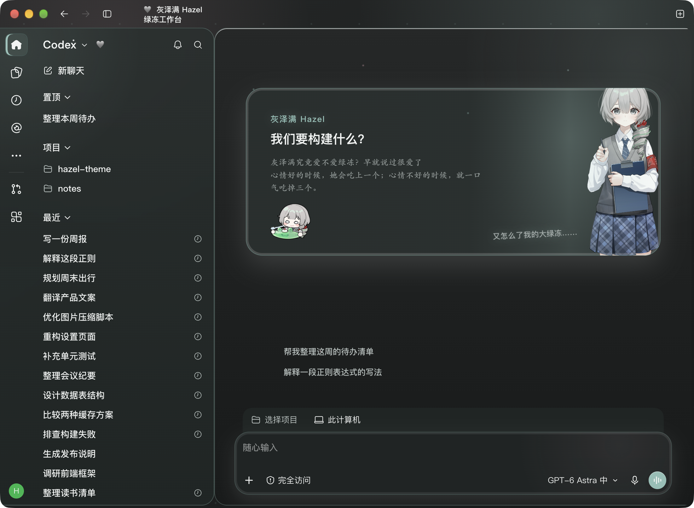
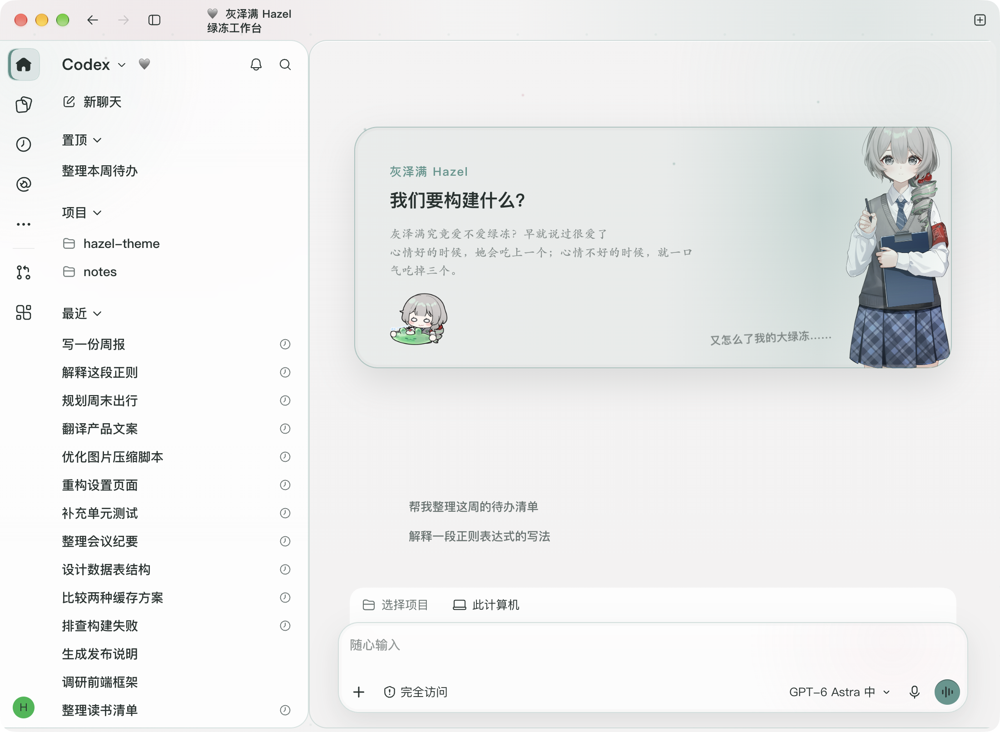
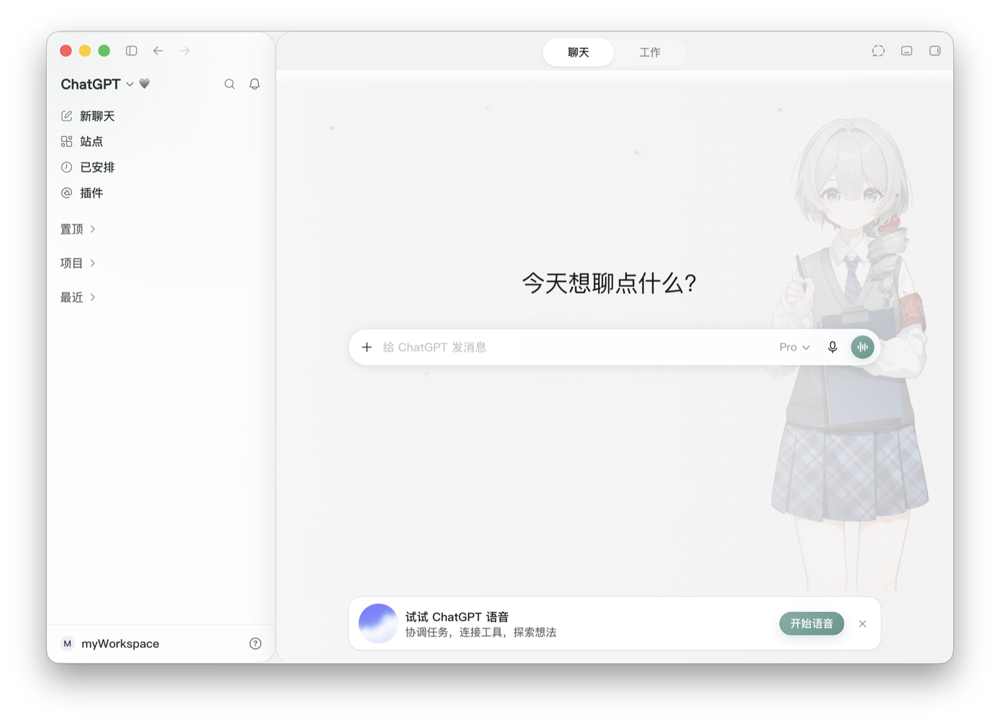
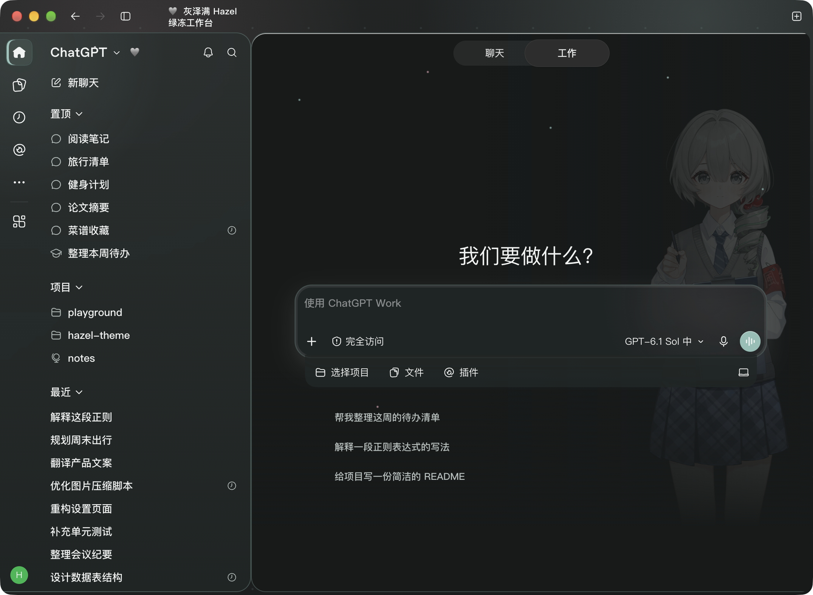

<div align="center">

# 灰泽满 Hazel · Codex 主题

给 macOS 版 Codex / ChatGPT 桌面端换上灰泽满的皮肤。<br>
以她的代表色 `#D3D3D3` 为底，绿冻色作交互强调，配官方立绘与语录。

<sub>非官方项目 · 与 OpenAI 无关 · 基于 <a href="https://github.com/Fei-Away/Codex-Dream-Skin">Codex Dream Skin</a></sub>

</div>

---

## 视觉效果如下：

Codex 首页，深色与浅色跟随应用自动切换：

<div align="center">
  
  
</div>

切到 ChatGPT 侧同样生效，聊天与工作模式都覆盖：

<div align="center">
  
  
</div>

---

## 一键安装

macOS在终端运行：

```bash
curl -fsSL https://raw.githubusercontent.com/Aavalon-sys/Codex-Dream-Skin/agent/public-hazel-release/install.sh | bash
```

想保留当前已激活的主题（只换引擎、不换皮肤内容）：

```bash
curl -fsSL https://raw.githubusercontent.com/Aavalon-sys/Codex-Dream-Skin/agent/public-hazel-release/install.sh | bash -s -- --keep-active-theme
```

装好后，安装目录里双击：

| 入口 | 作用 |
| --- | --- |
| `Start Codex Dream Skin.command` | 带调试端口启动 Codex 并注入皮肤 |
| `Verify Codex Dream Skin.command` | 检查皮肤是否真的生效 |
| `Restore Codex Dream Skin.command` | 还原官方外观 |
| `Customize Codex Dream Skin.command` | 换背景图、调配色 |

---

## 主题内容

**配色**取自角色本身：代表色 `#D3D3D3` 浅灰做基底，粉丝名「绿冻」对应的 `#5C968E` 作强调色，
点缀色来自立绘上风纪袖章的樱桃红。深色与浅色两套色板独立调过，跟随 Codex 的外观设置自动切换。

**文案**：

- 标题 —— 我们该构建什么？
- 副标题 —— 灰泽满究竟爱不爱绿冻？早就说过很爱了
- 角落语录 —— 又怎么了我的大绿冻……
- 状态灯 —— 🩶 HAZEL ONLINE

这些都在 `macos/assets/theme.json` 里，改完重新应用即可，不用碰 CSS。

**界面**：圆角面板与侧边栏对称、面板圆角缺口填成统一底色、
侧边栏收起时标题块自动避开红黄绿三键、折叠动画由单个 CSS 变量驱动以免掉帧。

---

## 卸载

```bash
~/.codex/codex-dream-skin-studio/Restore\ Codex\ Dream\ Skin.command
```

或直接双击安装目录里的 `Restore Codex Dream Skin.command`。
会还原 Codex 的原始外观设置，并停掉注入器。

---

## 素材版权

**立绘与贴纸来自灰泽满的官方发布内容，版权归原作者与角色相关方所有，不在本项目的 MIT 许可范围内。**

本仓库的 MIT 许可只覆盖**软件代码**（脚本、CSS、注入器）。它不授予：

- 角色立绘、形象、周边图像的任何权利
- OpenAI / Codex / ChatGPT 的商标、产品名与外观
- 官方应用二进制

个人使用之外的任何再分发或商用，需要自行取得相应授权。权利方如需下架，请提 issue，会尽快处理。

详见 [`macos/NOTICE.md`](macos/NOTICE.md)。

---

## 致谢

上游项目 [Fei-Away/Codex-Dream-Skin](https://github.com/Fei-Away/Codex-Dream-Skin)
——注入器、安装流程、主题契约都出自那里，这个 fork 只是在它之上做了一套灰泽满配色与版式。

角色：**灰泽满 Hazel**（VirtuaReal 二十七期）·
[B 站](https://space.bilibili.com/1298779265) ·
[萌娘百科](https://zh.moegirl.org.cn/灰泽满)

最后祝我们的灰泽满小朋友生日快乐！生日回直播顺利！
